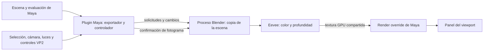

# Cómo funciona Eevee Maya Bridge

Este documento describe la arquitectura que implementa el código del repositorio. La versión declarada actualmente en el código es **0.6.25**. El puente permite ver una aproximación de la escena de Maya con Blender Eevee dentro de un panel de Maya; no reemplaza la escena original ni convierte Eevee en un motor escrito por Autodesk.

## Idea general

Maya sigue siendo el dueño de la escena. Evalúa el rig, los deformadores, la cámara y los materiales. El plugin lee esos resultados y mantiene una copia de visualización en un proceso separado de Blender. Blender renderiza esa copia con Eevee y comparte la imagen resultante con un renderizador personalizado que Maya muestra dentro del viewport.

El diseño evita escribir cambios de iluminación, cámara o materiales en la escena para poder dibujarla. El plugin sí ofrece controles que editan atributos nativos cuando el usuario los cambia; esos cambios siguen perteneciendo a Maya y se guardan con la escena.

## Qué ocurre al activarlo

1. Maya carga `plug-ins/eeveeBridge.py`. El plugin registra el comando `eeveeViewport` y prepara el menú **Renderer > Eevee** cuando el viewport de Maya está listo. El registro del menú no inicia Blender.
2. El cuadradito junto a Eevee abre los ajustes. Al escoger Eevee, `eevee_maya.ui` conecta un controlador (`Controller`) al panel activo y registra el render override.
3. El controlador crea un `Engine`, que inicia Blender como un proceso auxiliar oculto. Blender no abre el archivo `.ma` o `.mb`: recibe una representación de la escena preparada por el plugin.
4. En el primer envío se mandan geometría, materiales, cámara, luces, entorno y ajustes de color. Eevee prepara sus recursos y el viewport muestra un indicador de carga hasta recibir la primera imagen.
5. En los siguientes envíos se transmiten solo los cambios necesarios siempre que la escena no haya sufrido una modificación estructural.

Si el panel se cierra o Maya cambia temporalmente su layout, el controlador espera a que vuelva una vista gráfica válida. Después de que Eevee ya mostró una imagen, cambiar a Viewport 2.0 puede dejar Blender en pausa y reutilizarlo al volver a Eevee. La sesión pausada conserva memoria RAM y GPU; **Eevee > Detener Eevee y liberar memoria** termina el proceso y libera esos recursos.

## Cómo se sincroniza la escena

`exporter.py` consulta la escena desde Maya y traduce sus datos al formato del puente. Maya ya evaluó los skinClusters, blendShapes, rigs y otros deformadores: el exportador toma la malla resultante que se muestra, no intenta ejecutar esos deformadores dentro de Blender.

`changes.py` observa cambios del grafo de Maya, nombres, jerarquía, materiales, reproducción, Undo y Redo. Clasifica el trabajo para elegir entre:

- **Reconstrucción:** cambios estructurales como mallas o slots de materiales nuevos, cambios en topología o configuración que invalida recursos.
- **Actualización incremental:** cámara, transformaciones, visibilidad y puntos de malla que cambiaron. La DLL `bin/eevee_scene.dll` ayuda a obtener y empaquetar datos de malla para esta ruta.
- **Lectura ligera de luces y controles:** sus valores y relaciones se consultan por separado para evitar reconstruir geometría al mover una luz o variar sus atributos.

Al reproducir, Maya continúa evaluando la animación. El puente envía las nuevas posiciones y solicita otro fotograma; no precalcula la animación completa. La velocidad depende, entre otras cosas, del coste de evaluación en Maya, la cantidad de geometría visible, la preparación de materiales, la resolución, los efectos y la GPU. La calidad adaptativa puede reducir la resolución mientras se edita o navega y recuperarla al detenerse. No garantiza una frecuencia fija como 30 FPS.

## Comunicación y dibujo

Maya y Blender son procesos diferentes. Intercambian mensajes de solicitud y respuesta mediante buzones compartidos y metadatos de fotogramas. En el modo interactivo, el color y la profundidad se comparten por GPU con las bibliotecas nativas `bin/eevee_gpu_v5.dll` y las funciones de `gpu_share.py`. El uso de imágenes compartidas evita escribir y volver a leer cada fotograma desde disco.

El render override del plugin dibuja la textura en el panel de Maya. La coordinación de fotogramas evita que Blender sobrescriba una textura que Maya todavía está usando: Maya confirma cuándo terminó de presentarla. Si se cambia de resolución, los recursos de la generación anterior se conservan hasta que dejan de estar en uso.

La integración requiere **OpenGL Core Profile en Maya** y la interoperabilidad gráfica usada por el transporte GPU de Windows. El instalador actual está dirigido a Maya 2024 y contiene binarios compilados para ese SDK. No utiliza CUDA ni requiere núcleos RTX; sin embargo, la compatibilidad del transporte y del controlador debe validarse por GPU. Que una tarjeta no sea RTX no garantiza por sí solo que el intercambio funcione. El hardware certificado que declara el README es una RTX 3070.

## Qué se traduce

El puente traduce una selección de datos de Maya a nodos y recursos de Blender:

- Mallas evaluadas, transformaciones, normales, UV, visibilidad y materiales por cara.
- Preview Smooth Mesh de Maya cuando está activo, incluida su geometría suavizada evaluada.
- Cámaras de Maya, con su proyección de viewport para conservar encuadre, offsets y otros ajustes compatibles.
- Luces Point, Spot, Directional y Area; también algunos tipos de Arnold y Maya, con parámetros y light linking admitidos por el puente.
- Materiales Lambert, Blinn, Phong, Standard Surface y aiStandardSurface mediante una traducción a shaders de Blender. Texturas directas, UDIM, bump y algunas redes de textura 2D se leen o se hornean para su uso en Eevee.
- Arnold SkyDome con imagen lat-long HDRI, intensidad, exposición, rotación y visibilidad del fondo.
- Ajustes de sombras, oclusión ambiental, antialiasing, bloom, profundidad de campo y atmósfera volumétrica mediante los recursos correspondientes de Eevee o del dibujo GPU del puente.
- La configuración de color OCIO de Maya cuando puede cargarse en el proceso auxiliar.

El intercambio no hace que Eevee ejecute los nodos de Arnold. Traduce atributos y redes admitidas a equivalentes aproximados. Las funciones de viewport de Maya que sí se mantienen nativas —como la evaluación de rigs y deformadores— siguen a cargo de Maya.

## Playblast

Durante el playblast, el puente sigue la cámara y el tamaño de la captura, espera a que Eevee termine el fotograma solicitado y evita depender de que el viewport visible se haya actualizado a tiempo. Esto permite capturar secuencias de imágenes y alimenta la ruta de vídeo.

La adaptación opcional a Prism se instala en memoria cuando ambos plugins están cargados. Redirige únicamente su operación de playblast mientras dura la captura, comprueba que se hayan obtenido los fotogramas y restaura la función original al terminar. Para QuickTime utiliza el FFmpeg de Prism para producir un MOV; fuera de esa operación no sustituye el comportamiento de Prism.

## Alcance y límites

El resultado es una **vista previa acelerada para trabajar dentro de Maya**, no una reproducción idéntica de Arnold, de Viewport 2.0 ni del render final. Entre los límites importantes están:

- La traducción de materiales y redes de shading es parcial. Los nodos, utilidades, conexiones y atributos de Arnold que no tienen traductor pueden verse diferentes o faltar.
- Luces y decaimientos se aproximan a Eevee. Light linking, area lights, ambient lights y la iluminación HDRI tienen diferencias respecto a Arnold; algunas funciones solo están soportadas por objeto o para tipos de red específicos.
- Las sombras, la oclusión, el bloom, la profundidad de campo y la niebla tienen su propia implementación y coste. Sus controles no implican equivalencia exacta con el render de Maya.
- Las escenas grandes, redes procedurales, texturas de alta resolución, muchos deformadores o una salida Full HD pueden exceder el presupuesto de GPU o tardar en sincronizarse. La resolución adaptativa ayuda a navegar, pero reduce temporalmente el detalle.
- El intercambio GPU depende de la versión de Maya, sus binarios, el contexto gráfico y el controlador. El soporte comprobado es más limitado que la lista de GPUs capaces de ejecutar Blender por separado.

Para diagnosticar una instalación, el plugin guarda información de carga bajo `%LOCALAPPDATA%\EeveeMayaBridge\diagnostics`. El proceso Blender deja `blender.log` y archivos de estado en la sesión temporal que crea el motor. Los diagnósticos de rendimiento se guardan solo cuando se solicitan desde Maya.

## Archivos principales del repositorio

| Ruta | Función |
|---|---|
| `plug-ins/eeveeBridge.py` | Entrada del plugin Maya, comando, carga diferida y registro de Renderer. |
| `scripts/eevee_maya/ui.py` | Controlador del viewport, ciclo de actualización, menú y ciclo de vida del proceso. |
| `scripts/eevee_maya/engine.py` | Inicia Blender, intercambia solicitudes/respuestas y administra fotogramas. |
| `scripts/eevee_maya/exporter.py` | Lee y traduce geometría, materiales, luces, cámara y entorno de Maya. |
| `scripts/eevee_maya/changes.py` | Detecta qué datos cambiaron para evitar exportar toda la escena en cada actualización. |
| `scripts/eevee_maya/viewport.py` | Render override de Maya que presenta el fotograma recibido. |
| `scripts/eevee_maya/shared_frame.py`, `gpu_share.py` | Buzones y transporte de imágenes/handles GPU entre procesos. |
| `blender/viewport_worker.py` | Proceso interactivo de Blender: recibe cambios, renderiza Eevee y publica fotogramas. |
| `blender/scene_sync.py`, `worker.py` | Crea y actualiza la copia de la escena y configura los datos de render. |
| `native/`, `bin/` | Código C++ y DLL para el intercambio gráfico y el flujo eficiente de geometría. |
| `scripts/eevee_maya/settings_window.py` | Ajustes de viewport, luces, cámara, HDRI, sombras y efectos. |
| `scripts/eevee_maya/capture.py`, `prism_capture.py` | Sincronización de playblast y adaptación opcional a Prism. |
| `tools/build_release.py`, `packaging/` | Construcción del ZIP y del instalador para Windows. |

